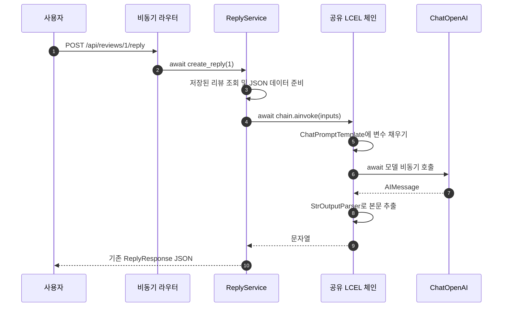
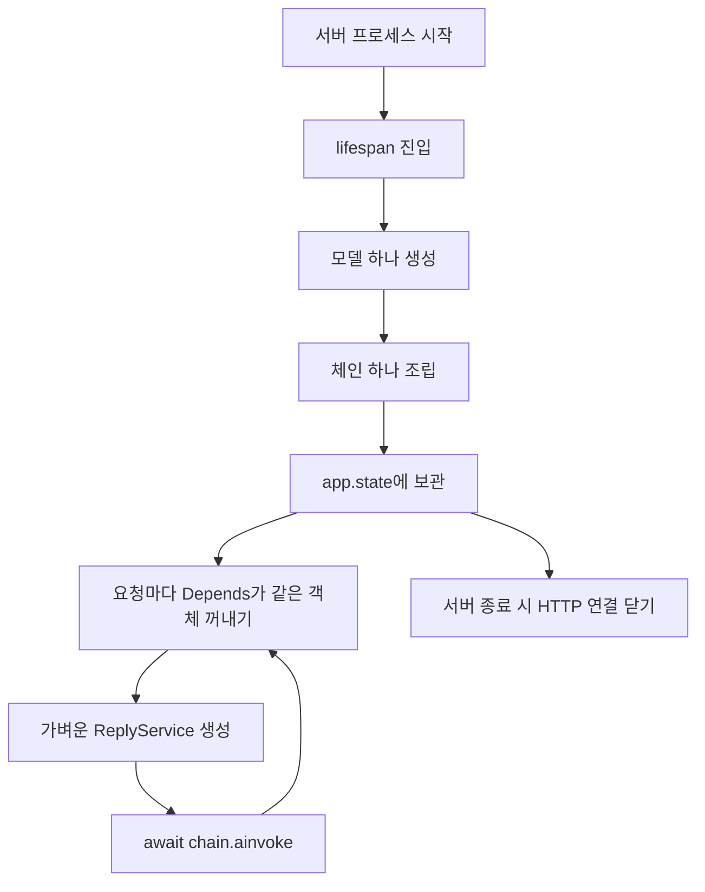
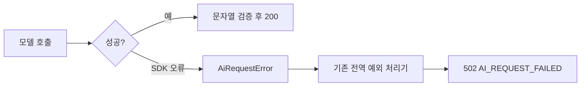

# 1단계: 직접 호출을 체인으로 바꾸기

## 먼저 실행하기

저장소 루트가 아니라 `ohgi-review-server` 폴더에서 실행합니다.

```powershell
cd C:\myLectureWs\refactor-langchain\ohgi-review-server
uv sync --python 3.14
uv run uvicorn app.main:app --port 8011
```

기본값은 가짜 모델입니다. http://127.0.0.1:8011/docs 에서 리뷰를 등록한 뒤 발급받은 ID로 답글 API를 호출하세요. 실제 호출은 `.env.example`을 `.env`로 복사하고 `FAKE_LLM=false`, 본인 API 키와 사용 권한이 있는 모델을 설정한 뒤 서버를 재시작합니다.

## 바뀐 흐름



`prompt | llm | StrOutputParser()`의 `|`는 앞 결과를 다음 부품의 입력으로 연결합니다. 물이 관을 따라 흐르는 것과 같습니다. 템플릿은 질문지, 모델은 작성자, 파서는 답변 봉투에서 본문을 꺼내는 부품입니다. `ainvoke`는 이 관 전체를 비동기로 실행합니다. API 응답을 기다리는 동안 이벤트 루프는 다른 요청을 처리할 수 있습니다.

## 생성은 한 번, 사용은 여러 번



`app.state`는 이 서버 앱의 공유 보관함입니다. `Depends`는 보관함에서 필요한 객체를 꺼내 서비스에 전달합니다. 요청마다 서비스 객체가 생겨도 모델과 체인은 다시 만들지 않습니다. 개발 모드 reload나 다중 worker에서는 **프로세스마다 한 번** 생성됩니다.

## 파일과 함수의 역할

| 파일·함수 | 하는 일 | 분리한 이유 |
|---|---|---|
| `clients/llm_client.py` | ChatOpenAI 생성, timeout·재시도·토큰 설정, HTTP 연결 종료 | 모델 설정을 한곳에서 관리 |
| `build_reply_chain` | 템플릿·모델·파서를 연결 | 요청 처리와 조립을 분리 |
| `ReplyService.create_reply` | 리뷰 조회 → 입력 데이터 → await 체인 → 응답 DTO | 업무 순서를 표현 |
| `main.py` lifespan | 시작 시 생성, 종료 시 정리 | 매 요청마다 연결 생성 방지 |
| `dependencies.py` | app.state의 공유 체인과 모델을 주입 | 테스트에서 부품 교체 가능 |
| `routers`, `schemas`, `repositories`, 예외 처리기 | 1단계에서는 원본 그대로 | 기존 API 계약 유지 |

JSON 직렬화는 리뷰 값에 따옴표·줄바꿈·중괄호가 있어도 데이터로 전달하기 위한 것입니다. JSON을 썼다는 이유만으로 프롬프트 주입이 완전히 방지되지는 않습니다. 원본 리뷰의 명령을 따르지 말라는 시스템 규칙도 함께 유지합니다.

## 오류와 스레드 확인



SDK 인증 오류·모델 없음·호출 제한·서버 오류는 `OpenAIError` 하위 타입입니다. 체인 경계에서 기존 `AiRequestError`로 바꾸므로 라우터에 try/except를 추가하지 않습니다. 키·상위 서버 오류 본문은 사용자에게 보내지 않습니다.

```powershell
uv run pytest -q
uv run python scripts/verify_local.py
```

1단계 확인: 15 tests passed, 7 unittest subtests passed. 로컬 Uvicorn에서 `/docs` 200, 등록 201, 답글 200, 검증 422, 없는 리뷰 404와 답글 `MainThread`를 확인했습니다. 잘못된 키/모델 오류는 실제 ChatOpenAI와 SDK를 거치고 HTTP만 MockTransport로 대체한 시험입니다. 실제 OpenAI 서버에 잘못된 키를 전송한 실험이나 유료 모델 품질 검증은 수행하지 않았습니다.

직접 확인하려면 fake 모드를 끄고 잘못된 키로 답글 요청을 보내 502를 확인한 뒤, 유효한 키와 존재하지 않는 모델로 같은 실험을 반복하세요. 생성자 로그는 `[model:create]`, 호출 로그는 `[chain:invoke]`입니다. TestClient의 테스트 스레드 이름과 실제 Uvicorn의 MainThread는 구분합니다. LCEL 내부의 짧은 동기 템플릿/파서는 실행기 스레드에서 동작할 수 있지만 네트워크 모델 호출과 요청의 비동기 흐름은 유지됩니다.

참고: [ChatOpenAI 공식 문서](https://docs.langchain.com/oss/python/integrations/chat/openai). 수업의 `01_chat_model`, `02_prompt_and_lcel`에 대응합니다.
