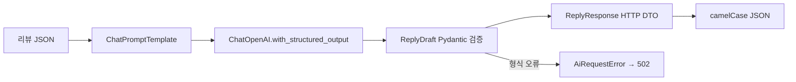

# 2단계: 답글과 메타데이터를 함께 받기

## 문자열과 객체의 차이

1단계는 본문 문자열만 받았습니다. 2단계는 Pydantic `ReplyDraft` 객체를 받습니다. 객체는 이름표가 붙은 상자입니다. `reply`에는 본문, `tone`에는 어조, `needs_followup`에는 후속 확인 여부를 넣습니다. JSON을 직접 잘라 읽지 않고 LangChain이 모델 출력을 스키마로 파싱합니다.



`prompt | structured_llm`에는 `StrOutputParser`를 붙이지 않습니다. 이미 구조화된 객체를 문자열로 바꾸면 필드 정보를 잃기 때문입니다. 1단계의 문자열 구현은 Git 이력의 `7352eff`에서 비교할 수 있습니다.

## 기능별 코드 설명

1. `domain/reply.py`: 모델에게 요구할 데이터 모양을 선언합니다. `Literal`은 어조를 사과·감사·일반 중 하나로 제한하고 `bool`은 참/거짓을 표현합니다. 필드 설명도 모델의 JSON 스키마에 전달됩니다.
2. `build_reply_chain`: 실제 모델에서는 `with_structured_output(ReplyDraft, method="json_schema", strict=True)`를 한 번 조립합니다. 설정한 모델이 이 방식을 지원해야 합니다. 지원하지 않는 모델 오류도 기존 502 흐름으로 전달합니다.
3. `create_reply`: `await chain.ainvoke(inputs)` 결과를 재검증하고 응답 DTO로 옮깁니다. 외부 응답이 잘못되면 200으로 위장하지 않습니다.
4. `schemas/review.py`: 기존 세 필드를 유지하고 `tone`, `needs_followup`만 추가합니다. 라우터와 저장소, 전역 예외 처리기는 변경하지 않습니다.
5. fake 모드: 별점과 일부 키워드로 결과를 정하는 오프라인 대역입니다. 실제 LLM의 판단 능력을 입증하는 시험이 아닙니다.

## 요청하고 확인하기

`POST /api/reviews`에 다음을 각각 등록합니다.

```json
{"customerName":"연습손님","rating":1,"content":"음식에서 이물질이 나왔어요. 확인해 주세요."}
```

```json
{"customerName":"연습손님","rating":5,"content":"음식이 맛있고 친절했어요."}
```

발급받은 ID로 `POST /api/reviews/{id}/reply`를 호출합니다. 예시는 다음과 같습니다.

```json
{"reviewId":1,"reply":"불편을 드려 죄송합니다. 남겨주신 문제를 담당자가 확인하겠습니다.","model":"fake-llm","tone":"사과","needsFollowup":true}
```

Python의 `needs_followup`은 기존 `CamelModel` 규칙으로 HTTP JSON에서는 **`needsFollowup`**이 됩니다. `/docs`에서 Try it out과 응답 스키마를 확인할 수 있습니다. 칭찬은 보통 감사·false, 불만은 사과·true입니다. 별점이 높더라도 환불·이물질이 있으면 후속 확인이 필요할 수 있습니다. 형식 검증은 의미의 정확성까지 보장하지 않으므로 실제 모델에서도 두 종류 리뷰를 비교하세요.

테스트: `uv run pytest -q`. SDK 오류 네 종류의 502 변환, 생명 주기, JSON 스키마, 실제 ChatOpenAI 파싱 경로(HTTP 대역), 별점별 fake 응답을 포함합니다.

참고: [LangChain 구조화 출력](https://docs.langchain.com/oss/python/integrations/chat/openai#structured-output). 수업의 `03_structured_output`에 대응합니다.
