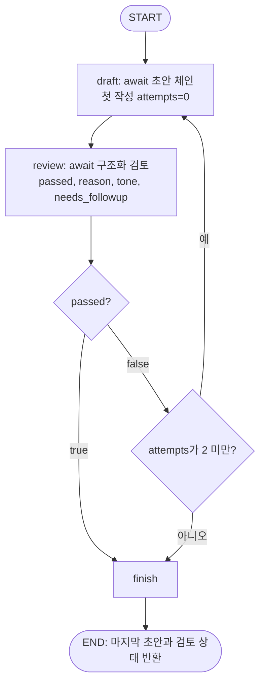

# 3단계: 초안 → 검토 → 재작성

## 왜 그래프를 쓰나요?

LCEL은 앞에서 뒤로 한 번 흐르는 연결입니다. 그래프는 검토 결과에 따라 되돌아갈 수 있습니다. 여기서는 LangGraph `StateGraph`를 사용합니다. `ReplyState`는 노드들이 함께 읽고 갱신하는 작업 노트이며 `TypedDict`는 그 노트의 필드 이름과 자료형을 설명합니다. 런타임 모델 출력 검증은 별도의 Pydantic `ReplyGrade`가 담당합니다.



여기서 **재작성 최대 2회 = 처음 1회 + 다시 2회 = 초안 생성 최대 3회**입니다. 첫 초안의 attempts는 0, 다음은 1, 마지막은 2입니다. `recursion_limit`도 보조 방어로 설정하지만 주된 종료 조건은 이 명시적인 카운터입니다. 모델의 자동 재시도는 0으로 유지하므로 그래프 밖에서 API 호출이 몰래 반복되지 않습니다.

## 코드별 역할

| 코드 | 역할 |
|---|---|
| `workflows/reply_graph.py` / `ReplyState` | 리뷰·별점·본문·피드백·횟수·최종 판정을 전달 |
| `build_graph` | 공유 모델로 draft·review 체인을 한 번 조립하고 compile |
| `draft` | 이전 본문과 피드백을 받아 `await draft_chain.ainvoke()` |
| `review` | 비난·핵심 불만 누락·어조·근거 없는 약속을 구조화 검토 |
| `route` | 통과 또는 상한 도달이면 finish, 나머지는 draft |
| `GraphReplyService` | 저장 리뷰를 읽고 `await graph.ainvoke()` 후 DTO로 변환 |
| `main.py`, `dependencies.py` | app.state 그래프 보관과 Depends 주입 |

그래프의 노드는 `async def`입니다. `route`처럼 짧은 조건문은 동기 함수로 둡니다. 검토의 `reason`은 다음 초안을 고치는 입력으로 쓰고 원문이 섞일 수 있어 터미널에 출력하지 않습니다. 로그에는 `passed`, `attempts`, 스레드 이름을 기록합니다.

2단계 체인은 코드와 테스트에 남아 있습니다. 현재 답글 API는 더 발전된 그래프를 실행합니다. 메타데이터는 검토 노드가 마지막 초안에 대해 판정하며 HTTP 응답에 `passed`, `attempts`를 추가했습니다. 미통과라도 상한에 도달하면 요구사항대로 마지막 초안을 돌려주되 **`passed=false`**로 표시합니다. 품질 미달과 API 장애는 구별합니다. API 장애·출력 형식 오류는 기존 전역 처리기를 통해 502가 됩니다.

## 직접 확인

```powershell
uv run pytest -q
uv run uvicorn app.main:app --port 8011
```

`/docs`에서 리뷰를 등록한 뒤 답글을 요청하세요. 기본 fake 검토는 항상 통과하는 경로 대역입니다. 실제 모델 판단을 흉내 내 정확도를 주장하지 않습니다. 까다로운 기준은 `review` 시스템 프롬프트를 강화해 실험할 수 있습니다.

자동 테스트 `tests/test_reply_graph.py`는 검토 결과를 `통과`, `미통과→통과`, `미통과→미통과→미통과`로 주입합니다. 세 경우 생성 횟수가 각각 1·2·3이고 마지막 시도에서 정상 종료하는지, 피드백이 다음 작성에 전달되는지 검사합니다. 이 테스트는 API 비용 없이 종료 조건을 확정적으로 확인합니다.

```text
[draft] attempts=0 thread=MainThread
[review] passed=False attempts=0 thread=MainThread
[draft] attempts=1 thread=MainThread
[review] passed=False attempts=1 thread=MainThread
[draft] attempts=2 thread=MainThread
[review] passed=False attempts=2 thread=MainThread
[finish] passed=False attempts=2
```

참고: [LangGraph Graph API](https://docs.langchain.com/oss/python/langgraph/graph-api). `10_langgraph_basics`, `12_rag_graph`의 상태·노드·조건부 엣지에 대응합니다.
