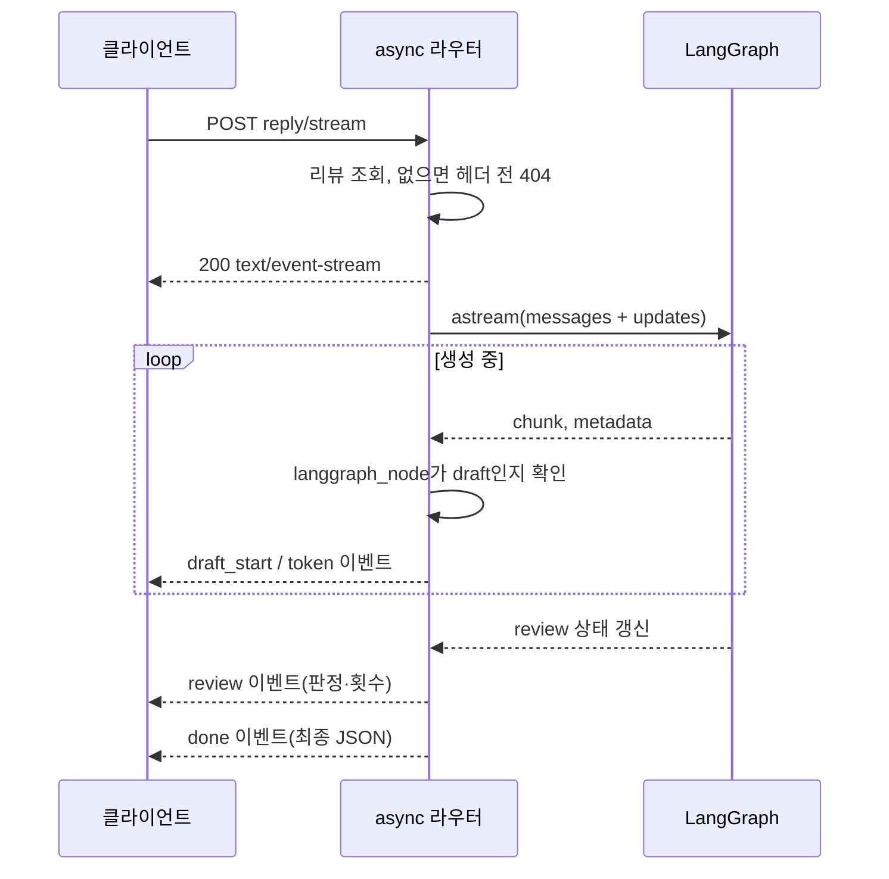
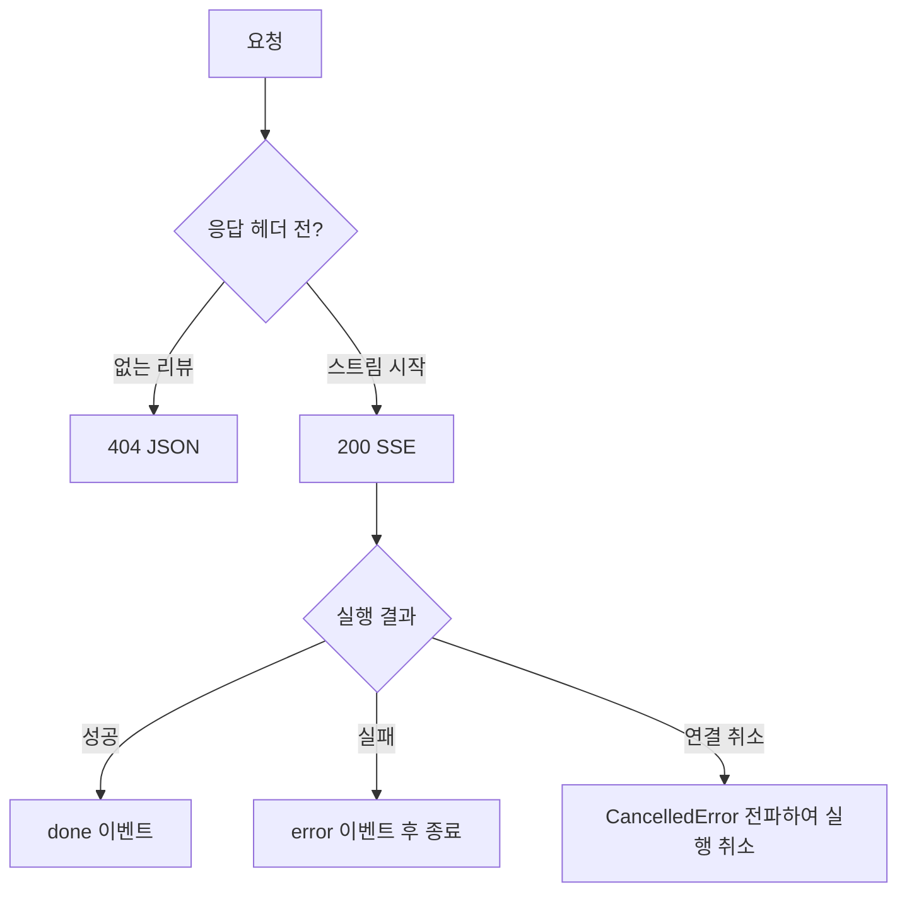

# 4단계: 완성을 기다리지 않고 토큰 받기

기존 `POST /api/reviews/{id}/reply`는 최종 JSON을 반환합니다. 새 `POST /api/reviews/{id}/reply/stream`은 `text/event-stream`으로 이벤트를 차례대로 보냅니다. 모델이 만든 조각을 즉시 전송하며 완성된 문자열을 나중에 잘라서 흉내 내지 않습니다. 한 조각은 항상 한 글자는 아니며 모델 토큰·단어·여러 문자일 수 있습니다.



`GraphReplyService.stream_reply`는 `messages`의 `(chunk, metadata)`에서 **draft 노드만** 통과시킵니다. 검토 모델의 내부 JSON과 피드백은 토큰으로 노출하지 않습니다. `updates`는 작성·검토 후 완성된 상태를 모아 `done`을 만들기 위해 함께 구독합니다. 그래프를 두 번 실행하지 않습니다.

## 이벤트 읽는 법

```text
event: draft_start
data: {"attempts":0,"provisional":true}

event: token
data: {"text":"소","attempts":0}

event: review
data: {"passed":true,"attempts":0}

event: done
data: {"reviewId":1,"reply":"소중한 의견 감사합니다.","model":"fake-llm","tone":"감사","needsFollowup":false,"passed":true,"attempts":0}

```

빈 줄은 이벤트 하나의 끝입니다. 본문은 JSON 직렬화하므로 답글의 줄바꿈이 이벤트를 깨지 않습니다. 재작성되면 새로운 `draft_start`가 옵니다. 화면에서는 그때 이전 임시 본문을 지우고 새 토큰을 붙이세요. 모든 시도의 토큰을 이어 붙이면 서로 다른 초안이 섞입니다. **스트리밍 본문은 검토 전 임시 초안**이고 `done.reply`가 최종 결과입니다. 검토 전 문장을 사용자에게 보일 수 없는 서비스라면 draft 토큰 공개 대신 검토 완료 후 결과를 전달하는 별도 정책이 필요합니다.

## 오류 처리



200 헤더를 보낸 뒤에는 502로 바꿀 수 없습니다. 그때는 `error` 이벤트에 `AI_REQUEST_FAILED`와 안전한 설명을 보내고 `done`은 보내지 않습니다. 키·SDK 원문·검색 데이터는 오류 응답에 넣지 않습니다. 일반 단건 API의 502 규칙은 유지합니다.

## 로컬 확인

먼저 ID 1 리뷰를 등록한 뒤 PowerShell에서 실행하세요. Windows에서는 별칭 혼동을 피하려고 `curl.exe`를 씁니다.

```powershell
curl.exe -N -X POST http://127.0.0.1:8011/api/reviews/1/reply/stream
uv run python scripts/verify_local.py
```

POST SSE이므로 GET 전용 브라우저 `EventSource`에 URL만 넣을 수는 없습니다. 브라우저에서는 `fetch`와 `ReadableStream`, Postman에서는 스트리밍 응답 보기를 사용하세요. `Cache-Control: no-cache`, `X-Accel-Buffering: no`를 보내지만 운영 프록시의 버퍼 설정도 별도 확인해야 합니다.

`verify_local.py`는 실제 로컬 Uvicorn을 실행하고, 여러 토큰 이벤트의 도착 시각이 벌어지는지 확인합니다. ASGI TestClient는 응답을 모아서 볼 수 있어 이것만으로 네트워크 실시간 전달을 입증하지 않습니다. fake 모델의 문자별 비동기 생성은 전송 경로 테스트이며 실제 OpenAI의 지연 측정은 아닙니다.

참고: [LangGraph Streaming](https://docs.langchain.com/oss/python/langgraph/streaming).
