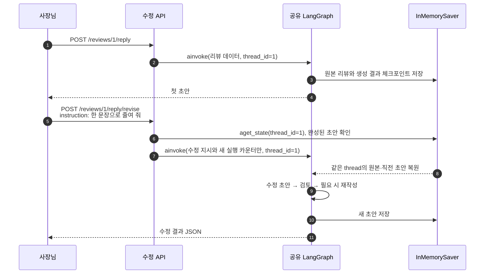
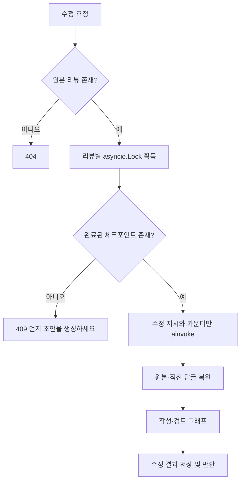

# 5단계: 이전 초안을 기억하고 수정하기

## 무엇이 기억되나요?

리뷰 저장소는 원본 리뷰를 보관합니다. LangGraph 체크포인터는 원본 리뷰를 포함한 **그래프 상태와 직전 답글**을 보관합니다. 둘은 다른 보관함입니다. 새 수정 API는 원본 리뷰 전체를 다시 받지 않고 `instruction` 한 줄만 받습니다.



## 코드 설명

1. `main.py`: lifespan에서 `InMemorySaver()` 하나를 만들고 `build_graph(..., checkpointer=saver)`로 컴파일합니다. 요청마다 saver를 새로 만들면 기억이 사라집니다.
2. `MemoryReplyService.config`: `{"configurable":{"thread_id":str(review_id)}}`를 생성합니다. 리뷰 1과 2는 다른 서랍을 사용합니다.
3. `revise_reply`: 리뷰 존재와 완료 체크포인트를 확인합니다. 이전 초안이 없으면 409, 없는 리뷰면 기존 404입니다.
4. `graph.ainvoke`: 수정 지시와 초기화할 카운터만 보냅니다. 원본·직전 초안은 체크포인터에서 복원됩니다. `draft_count=0`으로 수정 요청마다 최대 재작성 예산을 새로 시작합니다.
5. `draft`: 복원된 `reply`를 `previous_reply`로 템플릿에 넣고 수정 지시를 함께 전달합니다. 검토 단계도 다시 실행합니다. 정중하게 바꾸라는 지시가 보상 규정을 무시할 권한이 되지는 않습니다.
6. `reply_locks`: 같은 리뷰의 생성·스트리밍·수정을 한 번에 하나씩 처리합니다. 서로 다른 리뷰의 요청은 독립적으로 진행합니다. 스트림 취소 시 잠금도 해제됩니다.



## 실행 예

먼저 리뷰 등록과 `/reply` 생성을 실행한 뒤 호출합니다.

```powershell
curl.exe -X POST http://127.0.0.1:8011/api/reviews/1/reply/revise -H "Content-Type: application/json" --data-binary '{"instruction":"한 문장으로 줄여 줘"}'
```

Windows PowerShell의 버전에 따라 JSON 인용 처리가 다르면 `/docs`의 Try it out에 `{"instruction":"한 문장으로 줄여 줘"}`만 넣으세요. `review_text`, `rating`, 이전 `reply`는 요청에 넣지 않습니다. 공백 지시는 422입니다.

fake 모델은 한 문장 지시를 받으면 실제 직전 답글의 첫 문장을 반환해 맥락 복원 경로를 보여 줍니다. 실제 모델의 다양한 문체 수정 품질을 검증한 결과는 아닙니다.

## 기억의 한계

InMemorySaver는 프로세스 메모리입니다. `uvicorn --reload` 재시작이나 앱 종료로 기억과 기존 인메모리 리뷰 저장소가 초기화됩니다. worker를 여러 개 두면 각각 다른 기억을 가지므로 이 실습은 worker 하나로 실행하세요. 운영에서는 영속 체크포인터·공유 저장소·접근 제어·보존기간·분산 동시 실행 제어가 필요합니다. 체크포인터는 인증을 대신하지 않습니다.

테스트 `test_reply_memory.py`는 이전 답글·원본 복원, 리뷰별 격리, 초안 없는 수정의 409, 공백 422, 없는 리뷰 404, lifespan 재시작 시 초기화를 검사합니다.

참고: [LangGraph 체크포인터와 기억](https://docs.langchain.com/oss/python/langgraph/persistence).
