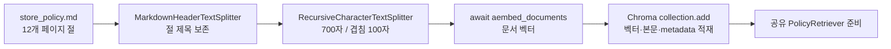
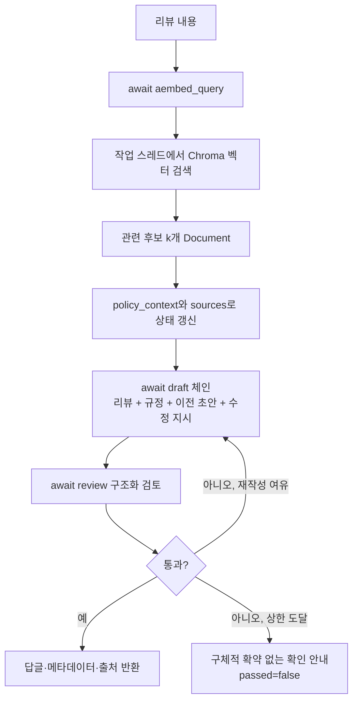

# 6단계: 매장 규정을 찾아 답글의 근거로 넣기

RAG는 Retrieval-Augmented Generation의 약자입니다. 모델을 새로 훈련하는 것이 아니라 **이번 요청과 관련된 문서를 찾아 이번 프롬프트에 함께 넣는 방법**입니다. 모델의 일반 지식으로 매장 혜택을 추측하지 않도록 만드는 것이 목적입니다.

## 시작할 때: 규정을 검색 가능한 숫자로 준비



`app/rag/policy_index.py`의 `split_policy`가 규정을 작은 `Document`로 나눕니다. `page_content`는 본문이고 `metadata`에는 원본 파일, 절 제목, chunk ID, 규정 버전을 담습니다. 글이 조각으로 나뉘어도 원래 어디에 있었는지 알 수 있습니다. 700·100은 문자 수 기준이며 토큰 수가 아닙니다.

문서 벡터는 `build_policy_index`에서 서버 시작 시 준비합니다. 실제 모드는 OpenAIEmbeddings의 **`await aembed_documents()`**를 사용합니다. 미리 얻은 벡터를 Chroma의 공개 `collection.add`에 전달하여 동기 원격 임베딩이 숨어 실행되지 않게 했습니다. Chroma 연결은 `langchain_chroma.Chroma`로 감싸 검색에 사용합니다.

실제 모드는 `.chroma/`에 보존합니다. 문서 내용·파일명·임베딩 모델·분할 버전이 같고 적재 건수가 정상이면 기존 컬렉션을 다시 열어 문서 재임베딩을 생략합니다. 문서나 모델이 바뀌면 다른 컬렉션을 사용합니다. 이 기능은 완전한 인덱스 발행/롤백 시스템이 아닙니다. 오래된 컬렉션 자동 삭제와 다중 프로세스 동시 구축은 구현하지 않았습니다.

## 요청할 때: 검색 → 작성 → 근거를 포함한 검토



`PolicyRetriever._aget_relevant_documents`는 질문을 비동기로 임베딩하고 Chroma의 동기 로컬 검색만 작업 스레드에 넘깁니다. 네트워크를 기다리는 모델·임베딩과 그래프 실행은 비동기로 연결되며 짧은 JSON 변환과 조건문은 동기로 유지합니다.

검색 결과는 `retrieve` 노드에서 `policy_context`로 합쳐 draft와 review에 전달합니다. 모델에게 규정 문서가 있다는 사실만 알려주는 것이 아니라 **실제 검색 본문을 프롬프트에 넣습니다.** review는 작성한 절차·수치·보상 표현이 규정에 있는지 함께 검토합니다. 재작성에서는 같은 검색 결과와 직전 피드백을 사용합니다. 수정 API의 새 실행에서는 원본 리뷰로 다시 검색하여 현재 규정 버전을 반영합니다.

## 환불 예제

등록 요청:

```json
{"customerName":"연습손님","rating":1,"content":"배달이 늦었어요. 환불해 주세요."}
```

답글의 의도는 “환불 요청은 주문 내용과 상황을 담당자가 확인한 뒤 절차를 안내하겠습니다”입니다. 환불 검토 절차와 환불 승인은 다릅니다. 이 규정집에는 자동 쿠폰·전액 환불·정액 보상 정책이 없으므로 그러한 혜택을 생성하지 않도록 시스템 프롬프트를 강화했습니다.

`has_unsupported_promise`는 대표적인 확약 표현을 보수적으로 추가 검사합니다. 심판 모델이 잘못 승인해도 이 규칙에 걸리면 재작성합니다. 두 번 재작성해도 검토를 통과하지 못하면 담당자 확인 안내로 전환하고 `passed=false`를 유지합니다. 3단계의 일반 그래프는 마지막 초안을 반환하지만, **규정 RAG가 켜진 6단계에서는 미통과 본문을 그대로 최종 반환하지 않는 보완**을 적용했습니다.

정규식은 모든 바꿔쓰기를 이해하지 못하고 정상적인 부정 문장을 과차단할 수 있습니다. 프롬프트와 LLM 검토도 의미적 정확성을 보장하지 않습니다. 이 구현을 환각이 절대로 발생하지 않는 시스템으로 해석하지 마세요. `sources`는 검색에 제공된 근거 후보 목록이며 답글의 문장별 인용 검증 완료를 뜻하지 않습니다. 운영 전 실제 모델·실제 규정·골든셋 평가가 필요합니다.

## 모드와 오류

| 구분 | 기본 fake 모드 | 실제 모드 |
|---|---|---|
| 답글 모델 | 비동기 데모 모델 | ChatOpenAI |
| 임베딩 | 단어·문자 해시 벡터 | OpenAIEmbeddings |
| 벡터 DB | 실제 Chroma, 임시 컬렉션 | 실제 Chroma, `.chroma/` 보존 |
| 외부 모델 호출 | 없음 | 문서·질문 임베딩 및 작성·검토 호출 |
| 입증하는 것 | 적재·검색·그래프·HTTP의 경로 | 별도 실행 시 실제 연결·의미 품질 확인 가능 |

```dotenv
FAKE_LLM=false
OPENAI_API_KEY=본인_키
OPENAI_MODEL=본인_계정에서_구조화출력을_지원하는_모델
RAG_ENABLED=true
EMBEDDING_MODEL=text-embedding-3-small
RAG_K=4
```

실제 모드는 임베딩과 작성·검토 모두 비용이 발생할 수 있습니다. 이 작업에서는 실제 유료 모델 품질 실험을 하지 않았습니다. 테스트는 실제 Chroma와 오프라인 임베딩 또는 HTTP 전송 대역을 사용합니다. 원격 임베딩의 native async 어댑터도 HTTP 대역으로 확인합니다.

서버 시작 시 잘못된 키·비어 있는 규정·불완전한 인덱스는 시작 실패로 드러납니다. 이미 실행 중인 서버의 질문 임베딩/검색 실패는 기존 `AiRequestError`로 변환하여 일반 API는 502, 시작된 SSE는 `error` 이벤트를 반환합니다. 근거가 아예 없으면 임의의 생성 대신 확인 안내를 사용합니다. 다만 top-k 검색은 무관한 후보를 돌려줄 수도 있으며, 별도 문서 관련성 채점 및 검색어 재작성 루프는 이 단계에 포함하지 않았습니다.

스트림의 draft 토큰은 검토 전 임시 초안입니다. `done.reply`가 검토를 마친 최종 답글입니다. 두 값을 같은 것으로 취급하지 말고 게시 전 사장님 확인을 거치세요.

검증 명령: `uv run pytest -q`, `uv run python scripts/verify_local.py`. 자세한 수업 대응은 [LECTURE_TO_CODE.md](LECTURE_TO_CODE.md)를 보세요.
